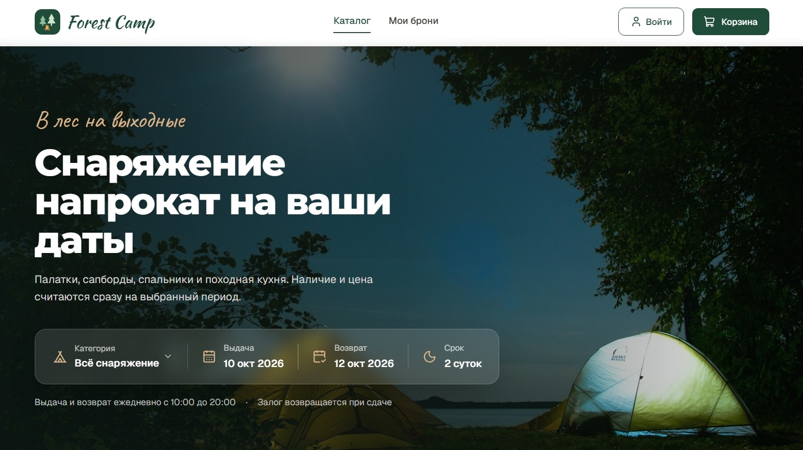

# Forest Camp

Витрина проката туристического снаряжения на Next.js 16 и React 19. Можно выбрать даты аренды, увидеть наличие и цену
на этот период, собрать корзину, оформить и «оплатить» бронь, посмотреть историю заказов.

В комплекте учебный REST API с данными в памяти. Витрина обращается к нему только по HTTP.

Vercel - https://forrest-camp.vercel.app/

## Стек

Next.js 16 (App Router) · React 19 · TypeScript · Tailwind CSS v4 · shadcn/ui + Radix UI



## Запуск

Нужен Node.js 22.6+.

```bash
npm install
npm run dev
```

Откройте http://localhost:3000. Демо-аккаунт: `demo@prokat.test` / `demo1234`.

| Команда | Что делает |
|---|---|
| `npm run dev` | dev-сервер |
| `npm test` | модульные тесты (`node:test`) |
| `npm run lint` | ESLint |
| `npm run typecheck` | проверка типов |
| `npm run build && npm start` | продакшен-сборка |

## Возможности

- **Каталог с состоянием в URL.** Фильтры, сортировка и страница хранятся в ссылке. Некорректные параметры
  исправляются, а пользователь видит, что именно было исправлено.
- **Цена и остаток на выбранные даты.** Формула стоимости одна для корзины и API, поэтому итог совпадает до рубля.
- **Корзина.** Пересчитывается через API, обрабатывает конфликт остатков (409), синхронизируется между вкладками.
- **Авторизация.** httpOnly-cookie, короткий access-токен и одноразовый refresh-токен с ротацией.
- **Учебные сценарии сбоев.** Панель на сайте включает отказ каталога, ошибку оплаты, конфликт брони
  и показывает, как интерфейс с ними справляется.

## Структура

```
src/
  app/          страницы и route handlers учебного API (app/api)
  components/   UI-компоненты и клиентские блоки
  lib/domain/   бизнес-правила: даты, каталог, цены, контакты (общие для клиента и API)
  lib/api/      типы контракта, ошибки, fetch для браузера и сервера
  server/mock/  данные и хранилище учебного API
```

