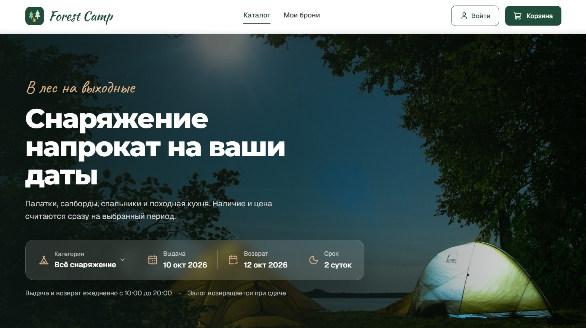

# Forest Camp

Витрина проката туристического снаряжения на Next.js 16 и React 19. Можно выбрать даты аренды, увидеть наличие и цену
на этот период, собрать корзину, оформить и «оплатить» бронь, посмотреть историю заказов.

Vercel - https://forrest-camp.vercel.app/

## Стек

Next.js 16 · React 19 · TypeScript · Tailwind CSS v4 · shadcn/ui + Radix UI



## Запуск

```bash
npm install
npm run dev
```

## Возможности

- **Каталог с состоянием в URL.** Фильтры, сортировка и страница хранятся в ссылке. Некорректные параметры
  исправляются, а пользователь видит, что именно было исправлено.
- **Цена и остаток на выбранные даты.** Формула стоимости одна для корзины и API, поэтому итог совпадает до рубля.
- **Корзина.** Пересчитывается через API, обрабатывает конфликт остатков, синхронизируется между вкладками.
- **Авторизация.** httpOnly-cookie, короткий access-токен и одноразовый refresh-токен с ротацией.
